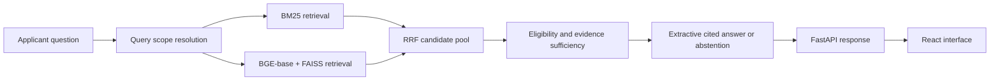

# IIIT Kottayam Applicant Assistant — Current Project Report

Report date: 22 October 2026  
Repository: `Notedpsyche/AI_Project`  
Project directory: `iitkasst/`  
Current Git commit: `14ae17b` (`Rename project directory to iitkasst`)

## 1. Executive summary

This repository contains a local, source-grounded assistant for prospective IIIT Kottayam applicants. It answers questions about selected public official information, including B.Tech admission, programmes, selected fee items, scholarships, reporting, and applicant requirements.

The assistant is not an open-ended chatbot and does not use Gemini, OpenAI, Ollama, or any other generative LLM to write answers. It retrieves evidence from a small curated local corpus, selects evidence that matches the requested programme/year/task, and returns extractive claims with links to the supporting official source.

The project is currently runnable locally. At the time this report was created:

- FastAPI backend health endpoint returned `ok`.
- The retrieval engine was loaded with `BAAI/bge-base-en-v1.5` on `cuda:0`.
- The React/Vite interface was available locally at `http://127.0.0.1:5173/`.
- The API was available locally at `http://127.0.0.1:8000/api`.

The project is an academic prototype, not an official IIIT Kottayam service. Users must verify consequential information such as dates, admissions, eligibility, and payments using the linked official sources.

## 2. What has been built

### Application stack

| Layer | Technology | Responsibility |
| --- | --- | --- |
| Frontend | React + Vite | Applicant-facing chat UI, conversation state, source/evidence display |
| API | FastAPI | Health, search, and chat endpoints |
| Sparse retrieval | BM25 | Exact terminology and keyword matching |
| Dense retrieval | BGE-base embeddings + FAISS | Semantic similarity retrieval |
| Hybrid retrieval | Reciprocal Rank Fusion (RRF) | Combines BM25 and dense candidate rankings |
| Evidence layer | Query scope + eligibility + sufficiency selection | Rejects wrong year, programme, task, route, or incomplete evidence |
| Answer layer | Deterministic extractive composer | Produces cited source-supported statements or abstains |

### Main request flow

### API routes

| Route | Purpose |
| --- | --- |
| `GET /api/health` | Reports backend, model, retrieval mode, and device status |
| `POST /api/search` | Returns retrieval evidence without a composed answer |
| `POST /api/chat` | Accepts a message and bounded conversation history; returns an extractive answer, citations, evidence, and context diagnostics |

## 3. Corpus and data handling

The system uses a curated allowlist in `configs/college_sources.json`, currently containing 10 public IIIT Kottayam HTML/PDF sources. It is deliberately not a full unrestricted website crawler.

The collector records provenance for each extracted item, including source URL, title, document type, programme, admission year/effective period, retrieval time, and stable section/chunk identifiers. HTML sections and fee-table rows are converted into retrieval units so that a question about one fee component can be answered from the relevant row instead of an entire page.

The following remain local and are excluded from Git:

- Downloaded source pages and PDFs
- Processed chunks
- BM25 indexes, FAISS indexes, and embedding files
- Local model artifacts
- Local results and judgments

This policy avoids publishing copied institute content or derived artifacts without confirmed redistribution permission. A new user builds these files locally after cloning.

## 4. Important implemented behaviours

### Query understanding

The assistant resolves:

- B.Tech, e-M.Tech, and PhD separately
- B.Tech specializations including CSE, ECE, Cyber Security, AI and Data Science, and Mathematics and Computing
- Admission year separately from Class 12/qualification-passing year
- Admission routes such as JoSAA/CSAB and DASA
- Fee components, totals, deposits, charges, and semester references
- Named document requirements, including laptop, vaccination, Aadhaar, passport, score card, and photographs
- Admissions, portal steps, reporting, orientation, class commencement, scholarships, placements, departments, and campus facilities
- Conversational follow-ups using bounded previous user context

An explicit new programme or year does not inherit the previous topic. A short referential question such as “And the next semester?” can inherit the prior fee component/year when the conversation provides that scope.

### Evidence safety checks

An official source is not accepted merely because it is topically related. The system checks whether the selected passage supports the requested:

- Entity or programme
- Admission year/effective period
- Admission route, where relevant
- Requested fee component and semester
- Requested document item
- Requested task or attribute

Examples:

- A recruiter question needs recruiter evidence; a generic placement page is insufficient.
- A total-fee question needs a total, not tuition alone.
- A third-semester fee question must not use a first-semester value.
- An unsupported statistic should produce an abstention, not a plausible guess.

### Answer composition

Answers are constructed from exact evidence text and cite their evidence rank. The composition layer handles:

- Programme lists and programme fields
- Admission process and portal steps
- Reporting, orientation, and class-commencement details
- Fee components, fee totals, comparisons, and requested semesters
- Document requirements
- Scholarship support/authorities
- Hostel items and transport arrangements
- Multi-part questions where the selected evidence set is sufficient

When evidence is missing, conflicting, ambiguous, wrong-year, or incomplete, the assistant returns a conservative refusal/clarification rather than inventing information.

## 5. Quality work completed

The project originally exhibited failures involving short conversational follow-ups, wrong-task evidence, weak programme/course understanding, overly broad fee answers, and irrelevant document answers.

The implementation added and improved:

- `backend/services/college_query.py` for structured query scope and context resolution
- `backend/services/college_select.py` for eligibility and evidence sufficiency checks
- `backend/services/college_answer.py` for task-aware extractive answers
- `src/doc2dial_retrieval/search.py` for conversational contraction normalization before retrieval
- College-specific ingestion, source manifest, experiment, trace, smoke, and evaluation scripts
- Regression tests covering corrected failure categories

The project retained its BM25, BGE-base, FAISS, and RRF architecture. It did not replace the corpus with an external dataset, fine-tune BGE, add an LLM, or rebuild the frontend.

## 6. Latest recorded validation results

The saved evaluation artifact at `results/college/independent_evaluation.json` records the following final **development-regression** result:

| Measure | Recorded result |
| --- | ---: |
| Total cases | 45 |
| Strictly correct | 45/45 (100%) |
| Answerable cases, correct and complete | 36/36 |
| Correct abstentions | 9/9 |
| Unnecessary abstentions | 0 |
| Unsupported answers | 0 |
| Citation support | 36/36 (100%) |
| Conversational follow-ups | 3/3 correct |
| Recall@5 | 77.8% |
| Recall@10 | 83.3% |
| MRR@10 | 0.711 |
| nDCG@10 | 0.736 |
| Recorded warm API p50 latency | 2.02 seconds |
| Recorded warm API p95 latency | 2.87 seconds |

These figures are not an independent accuracy claim. The 45 cases were used during development and fixes were informed by their observed failures. The report correctly treats them as regression coverage. A separate independently authored and human-reviewed held-out set is required for a defensible final effectiveness claim.

Other completed checks from the final implementation pass:

| Check | Result |
| --- | --- |
| Python test suite | 58 passed |
| Ruff static checks | Passed |
| Frontend production build | Passed |
| Local API smoke suite | 20/20 expected behaviours passed |
| Backend health endpoint | Returned `ok` |

## 7. Current limitations

The application works for the bounded source set, but these limitations remain important:

1. The corpus is incomplete. It currently lacks reliable official evidence for some placement counts/packages/recruiters, scholarship award amounts/income limits, department heads, laboratory locations, and nearby hotel prices.
2. The assistant should abstain on those unsupported categories; abstention is intentional, not a failure to generate an answer.
3. Retrieval Recall@10 is 83.3%, so some annotated evidence is still not retrieved in the top 10. An answer may still be correct if another official source supports the same fact.
4. Admission and fee information changes over time. The local corpus and indexes must be rebuilt after official source changes.
5. The recorded quality set is development data. It must not be presented as independent test performance.
6. The local service is not shared automatically. Each collaborator who clones the project runs their own local backend, frontend, downloaded sources, indexes, and chat history.

## 8. Reranker and LLM decision

The code includes a controlled optional reranker experiment path, but no learned reranker is deployed by default. The current RRF baseline remains deployed because the observed quality problems were corrected through query understanding, structured eligibility, evidence sufficiency, and extractive composition.

No generative LLM is used. Adding a grounded LLM is not the next required step because it could make unsupported answers sound more convincing. A future LLM experiment should only be considered after independent evaluation, and only with strict evidence-only prompting, citation verification, and retained abstention behaviour.

## 9. How a new collaborator runs the same project

1. Clone `https://github.com/Notedpsyche/AI_Project.git`.
2. Enter `AI_Project\iitkasst`.
3. Run `uv sync`.
4. Run `uv run python src/prepare_college.py all`.
5. Run `uv run python src/index.py`.
6. Start the backend: `uv run python -m uvicorn backend.main:app --host 127.0.0.1 --port 8000`.
7. In a second terminal, enter `app\frontend`, run `npm ci`, then `npm run dev`.
8. Open `http://127.0.0.1:5173/`.

The full step-by-step guide is in `SETUP_FOR_NEW_USER.md`.

## 10. Key files

| File or directory | Role |
| --- | --- |
| `README.md` | Project overview and quick setup |
| `SETUP_FOR_NEW_USER.md` | Detailed fresh-clone setup guide |
| `QUALITY_IMPROVEMENT_REPORT.md` | Implementation/fix and regression-result report |
| `INDEPENDENT_QUALITY_AUDIT.md` | Pre-fix audit and evidence trace |
| `configs/college_sources.json` | Official-source allowlist |
| `backend/services/college_query.py` | Query scope and follow-up resolution |
| `backend/services/college_select.py` | Evidence eligibility and sufficiency selection |
| `backend/services/college_answer.py` | Extractive cited answer composition |
| `src/prepare_college.py` | Source collection and local preparation command |
| `src/index.py` | BM25/FAISS index build command |
| `evaluation/` | Question sets, annotation guide, traces, and evaluation tools |
| `tests/` | Unit and regression test coverage |

## 11. Recommended next work

The safest next milestone is evaluation rather than adding more features:

1. Freeze the current code and source manifest.
2. Create a new independently authored, human-reviewed held-out question set.
3. Include hard examples for incorrect year, wrong programme, unsupported statistics, and conversational scope changes.
4. Measure BM25, dense, hybrid RRF, and any optional reranker at equal retrieval cutoffs.
5. Retain a reranker only if it improves held-out evidence ranking without harming source/year safety.
6. Refresh the corpus/indexes whenever the official IIIT Kottayam sources change.

This keeps the project honest, reproducible, and suitable for a local academic demonstration.
