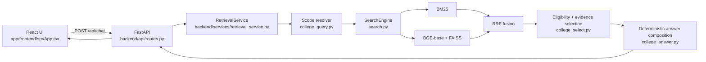

# Current Architecture Audit

## Scope and evidence standard

This report describes the repository as inspected on 22 October 2026. It is an analysis artifact, not an implementation claim. Findings are labelled as **confirmed** when directly supported by code, local data, a bounded runtime trace, or a saved evaluation artifact. Items not demonstrated by the repository are labelled as gaps or hypotheses.

## System boundary

The active application is a local IIIT Kottayam applicant assistant. It does **not** use a generative LLM. It retrieves official-source chunks and constructs answers deterministically from selected evidence.

## Request path

| Stage | Active file/function | Current behavior | Audit finding |
|---|---|---|---|
| Chat state | `app/frontend/src/App.tsx` | Stores messages in the browser and sends the complete message list on each chat request. | **Confirmed.** There is no server-side conversation store. |
| API | `backend/api/routes.py` | Exposes `/api/health`, `/api/search`, and `/api/chat`; maps selected evidence to citation cards. | **Confirmed.** Chat handlers are synchronous. |
| Scope resolution | `backend/services/college_query.py::resolve_scope` | Uses regex-derived topic, intent, programme, year, semester, route, and a narrow continuation test. | **Confirmed.** Only the immediately preceding user message in the last six messages is considered; the assistant answer is ignored. |
| Query construction | `backend/services/retrieval_service.py`, `SearchEngine.build_query` | Uses the current question, or previous-user-plus-current when the resolver says context is required. | **Confirmed.** This is concatenation, not semantic rewrite. |
| Sparse retrieval | `src/doc2dial_retrieval/retrieval.py::BM25Retriever` | BM25 over title, heading, and text with `k1=1.5`, `b=0.75`. | **Confirmed.** Retrieval depth is 50 before fusion. |
| Dense retrieval | `src/doc2dial_retrieval/retrieval.py::DenseRetriever` | BGE-base query prefix, normalized embeddings, FAISS `IndexFlatIP`. | **Confirmed.** With normalized vectors, inner product implements cosine ranking. |
| Fusion | `src/doc2dial_retrieval/retrieval.py::hybrid` | Unweighted reciprocal-rank fusion with configured `k=60`. | **Confirmed.** No learned fusion weights. |
| Eligibility | `backend/services/college_query.py::eligible` | Rejects candidates conflicting with parsed programme, topic, route, semester, or year metadata. | **Confirmed.** This happens after retrieval and after per-retriever text-only deduplication. |
| Evidence selection | `backend/services/college_select.py::select_evidence` | Applies eligibility and limited task support checks, then manual score bonuses or an optional six-feature logistic model. | **Confirmed.** No reranker model is deployed because `models/college_reranker.json` is absent. |
| Sufficiency | `backend/services/college_select.py::supports_request`, `evidence_set_sufficient` | Has narrow checks for selected fee/document/portal intents; otherwise defaults to sufficient. | **Confirmed.** This permissive default is a major reliability weakness. |
| Answering | `backend/services/college_answer.py::grounded_answer` | Uses task-specific patterns and lexical sentence scoring, then emits cited extracts. | **Confirmed.** No calculation engine, entailment model, or general multi-passage planner is active. |

## Corpus and indexing

The active allowlist contains 10 official-source entries and produces 98 chunks. Distribution is highly uneven: 50 chunks come from “UG Admission 2026,” 12 from the B.Tech fee source, 15 from the B.Tech AI page, seven from the portal PDF, and only one from scholarships. The processed corpus contains no chunk tagged for placements and only one tagged for departments. There are no complete active sources for e-M.Tech, PhD, placement statistics, academic calendars, or broad campus facilities.

The college ingester is `src/doc2dial_retrieval/college.py`:

- HTML is reduced to headings, visible lines, and table rows, then split with a fixed 220-word boundary.
- PDF text is split page-wise using the same flat word-window approach.
- Heading hierarchy, merged table headers, footnotes, and parent-child relationships are not reliably preserved.
- Source-level programme and admission year metadata are propagated to chunks.
- Any additional four-digit year in the text may become `year_conflict`, even when it is a qualification/passing year rather than an admission year.
- Route information is encoded in heading text rather than a typed metadata field.
- Replacement characters were observed in processed headings, showing extraction quality loss.

The configured chunk target/max values are not used by this college extraction path. Indexing in `src/index.py` embeds `title + heading + text`, normalizes vectors, and builds an exact `IndexFlatIP`. At 98 chunks, exact FAISS search is appropriate and is not a meaningful scalability bottleneck.

## Duplicate handling

Sixteen exact duplicate text groups exist. Examples include B.Tech admission procedure text repeated across overview and 2026 admission sources, certificate requirements repeated across JoSAA and DASA routes, and fee rows repeated on programme and fee pages.

`dedupe_results` in `src/doc2dial_retrieval/retrieval.py` compares text, not source/version/programme/route metadata, and is called inside each retriever before eligibility filtering. Therefore a duplicate carrying the correct route or year can be removed while a semantically identical but incorrectly scoped copy survives. This is a **confirmed design defect** and a plausible cause of scope-specific misses.

## Query model and dialogue state

`QueryScope` represents one programme string, one intent string, topic, one year, semester numbers, route, fee components, and a few booleans. It cannot faithfully represent comparisons or multi-entity questions. `programme_in` resolves a single label; because ECE is tested before CSE, “Compare CSE and ECE” collapses to ECE. Admission year and qualification year are not typed separately.

Conversation handling is heuristic rather than stateful. A follow-up must match a surface-reference pattern and be judged underspecified. When accepted, only the preceding user question is prepended. Important slots such as semester and requested attribute are not carried as typed state. New-topic detection is therefore fragile in both directions: legitimate elliptical follow-ups can lose scope, while concatenation can introduce stale words.

## Answer model

`college_answer.py` is transparent and source-bound, but it mixes generic lexical extraction with task-specific strings. Several exact source facts are embedded directly in code, including reporting dates, class commencement, a first-semester total, laptop specifications, and hostel items. This is brittle when source versions change and makes the saved regression result vulnerable to test-guided overfitting.

The composer cannot reliably:

- aggregate all-semester totals;
- compare multiple programmes;
- guarantee list completeness;
- decompose multi-part questions;
- distinguish application deadlines from portal submission instructions;
- validate that each emitted claim answers the requested attribute.

## Configuration and operational state

- Active model: `BAAI/bge-base-en-v1.5`, 768 dimensions.
- Index/corpus alignment is checked with hashes at startup.
- The active health endpoint reports CUDA on the local RTX 4050.
- The configured evidence-selection weights are not consumed by the active college selector; active ranking bonuses are code-level constants.
- `uv run ruff check .` passed during this audit.
- `uv run python -m pytest -q` passed 58 tests in 7.53 seconds.
- `uv run pytest -q` failed because the console-script trampoline still referenced the pre-rename directory; this is a tooling/setup defect, not a test failure.

## Reusable and non-reusable components

Preserve: FastAPI routes, React shell, provenance-bearing evidence cards, BM25, BGE-base, normalized FAISS, RRF, manifest hashing, and extractive fallback.

Refactor: the flat ingester, metadata schema, duplicate handling order, regex-only scope representation, conversation state, permissive evidence sufficiency, hard-coded claim patterns, and evaluation protocol.

Retire from the active mental model: old Doc2Dial services (`context_service.py`, `intent_service.py`, `evidence_selector.py`, `answer_service.py`, `confidence_service.py`). They remain in the repository and tests but are not called by the current college routes.

