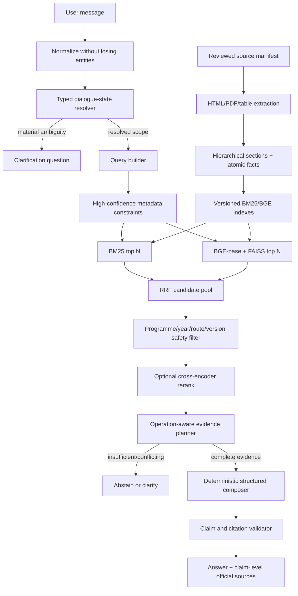

# Target Architecture

## Design goal

Produce answers only when the system can identify the user’s requested entity, attribute, temporal scope, and operation and can assemble a complete set of authoritative official facts. Preserve the current retrieval stack and transparent citations.

## Candidate architectures

| Candidate | Accuracy potential | Paper connection | Engineering/resources | Latency/deployment | Hallucination/maintenance |
|---|---|---|---|---|---|
| **A. Improved retrieval-only** — structured corpus, typed scope, BM25+BGE+RRF, deterministic planner/composer | High for facts supported by the corpus; limited prose synthesis | Moderate through structure, metadata, transparency | Moderate; fits current laptop and simple hosting | Lowest expected latency and deployment complexity | Lowest hallucination risk; maintainable schemas/rules |
| **B. Controlled RAG** — Option A plus a local or hosted generator after evidence planning | Potentially higher for multi-document prose and multi-part answers | Weak; RAG is only future work in the paper | High; local VRAM or hosted cost/privacy/network | Highest latency and operational complexity | Highest validation burden; deterministic fallback required |
| **C. Paper-oriented** — explicit FSM, hierarchical metadata classifier/filter, BERT centroid/WMD ranking, extractive output | Uncertain practical gain; useful academic reproduction | Strongest | High experimental work; WMD and labeled metadata required | WMD adds latency; private paper data prevents exact replication | Low hallucination but potentially brittle/obsolete retrieval choices |
| **D. Recommended hybrid** — Option A plus paper-inspired FSM/hierarchy and a gated cross-encoder; WMD as separate experiment | Highest expected practical quality without premature generation | Strong and defensible adaptation | Moderate-high, staged and measurable | Expected to remain viable on RTX 4050 and ordinary CPU hosting; benchmark required | Low hallucination; modular rollback and clear ownership |

Option D is recommended. It captures the paper’s strongest transferable ideas while retaining the more modern BGE/RRF baseline and transparent deterministic answering.



## Data model

### Source record

`source_id`, canonical URL, title, document type, authority, programme(s), route(s), publication/effective dates, admission years, retrieved time, content hash, supersedes/superseded-by, access status, review state.

### Hierarchical content record

`node_id`, `parent_id`, source ID, heading path, page/section/table coordinates, raw text, normalized text, extraction-quality flag, and stable provenance anchor.

### Atomic fact

`fact_id`, node ID, fact type, subject, attribute, value, unit/currency, programme, specialization, route, admission/effective/qualification year, semester, qualifiers, and completeness group. The raw passage remains available for display and verification.

Atomic facts do not replace text retrieval. They provide deterministic validation and composition for structured requests such as fees, dates, counts, and checklists.

## Dialogue and query contract

The resolver emits:

```text
intent: admissions | eligibility | fees | programmes | scholarships | placements | facilities | ...
operation: lookup | list | count | aggregate_total | compare | procedure | deadline | verify
programmes: zero or more normalized programme IDs
route: optional route ID
admission_year / effective_year / qualification_year: distinct fields
semesters and fee_components: zero or more values
requested_attributes: one or more fields
context_provenance: current turn or inherited turn ID per slot
confidence and ambiguity reasons
```

State transitions are deterministic and observable. Explicit programme/year/topic changes reset incompatible slots. Pronouns and short follow-ups inherit only compatible slots from the last accepted scope. If two plausible scopes lead to different answers, ask one concise clarification rather than retrieving broadly.

## Retrieval contract

- Exact metadata constraints are applied before ranking only when explicit or high confidence.
- An uncertain resolver may run one constrained and one fallback retrieval branch.
- BM25 and BGE receive the same normalized query and eligible source universe.
- RRF remains the default fusion method.
- Deduplication uses canonical fact/source lineage and retains distinct versions/routes.
- Dense confidence is not treated as answer confidence.
- Candidate and selected-evidence traces include stage scores and rejection reasons.

## Evidence planner

Each operation defines a schema:

| Operation | Required evidence |
|---|---|
| Procedure | Ordered steps or authoritative process description for exact programme/route/year. |
| Deadline | Date plus explicit deadline type, programme/route, and valid period. |
| List | Items sharing a complete-list group and scope. |
| Count | Named statistic, population, period, and unit. |
| Aggregate total | Complete components/periods or an authoritative stated total; deterministic arithmetic and displayed breakdown. |
| Compare | Same attributes for every target, with gaps declared. |
| Eligibility | Requirement set for exact programme/route/year; qualification-year references must not be interpreted as source conflicts. |

Selection returns either a complete `AnswerPlan` or a structured insufficiency reason. Unknown intents never default to sufficient.

## Answer and citation contract

The deterministic composer renders the plan as prose, a list, a comparison table, or a calculation. It may combine several passages but cannot introduce a value absent from verified facts or deterministic arithmetic. Every claim records supporting `fact_id`/`node_id`; the API translates these to source URL, title, heading/page, programme, route, year, and retrieved date.

Before output:

1. validate all numbers, dates, names, and qualifiers against facts;
2. confirm each requested attribute is answered or explicitly marked unavailable;
3. reject conflicting active versions;
4. ensure each claim has at least one valid official citation;
5. abstain if any critical contract fails.

## Optional components

### Cross-encoder

Position after RRF and deterministic safety filters, before evidence planning. It ranks query-passage pairs but cannot override version/route exclusions. Start with top 20–30 candidates and a small MiniLM model; compare a BGE reranker under the same protocol.

### WMD

Keep outside the default request path unless evaluation demonstrates a quality/latency benefit. It may rerank a bounded candidate set for the paper comparison.

### Local LLM

Feature-flagged and off by default. It receives only a completed evidence plan and must return structured claims with evidence IDs. The deterministic validator remains authoritative. If validation fails or latency is excessive, fall back to deterministic composition.

## API compatibility

Keep `/api/health`, `/api/search`, and `/api/chat`. Extend responses rather than breaking current UI fields:

- resolved scope and inherited-slot provenance;
- answer behavior (`answer`, `clarify`, `abstain`);
- claim-level evidence IDs;
- source route/effective period/version;
- debug-only stage traces and rejection reasons.

The UI can continue displaying source cards while progressively adding clarification and comparison/table rendering later.

## Operational properties

- Index build is explicit, reproducible, and bound to source/corpus/model/config hashes.
- Startup fails with a clear rebuild command when any artifact is stale or absent.
- Source fetches are gentle, allowlisted, and local-only; copied source content is not committed publicly.
- A source update creates a new version and triggers review/evaluation before activation.
- Logs avoid storing personal applicant data.

