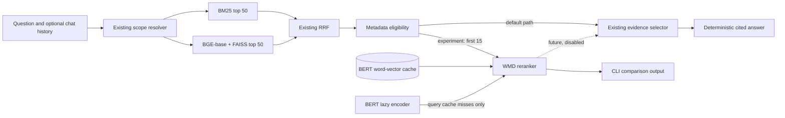
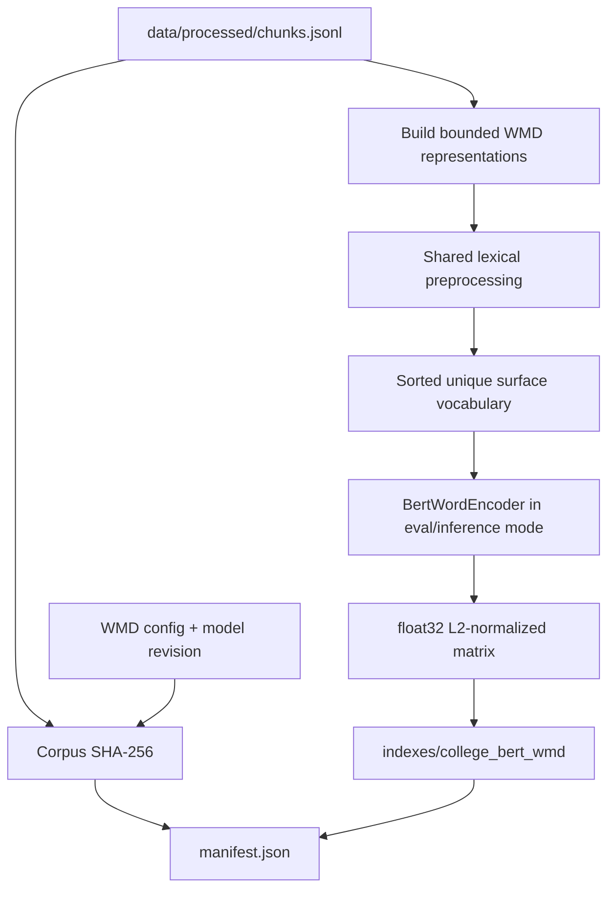

# Revised Architecture — Frozen Implementation Design

## Status and scope

This is the authoritative implementation architecture. It supersedes the optional architecture choices in the earlier planning reports without overwriting them. The production path remains BM25 + BGE-base + FAISS + RRF. BERT + Word Mover's Distance (WMD) is a separate experiment and is disabled in the web application by default. No generative model or RAG layer is included.

## Frozen decisions

| Decision | Selected implementation | Reason and limitation |
|---|---|---|
| BERT | `google-bert/bert-base-uncased`, revision `86b5e0934494bd15c9632b12f734a8a67f723594` | Closest standard model to the paper: 12 layers, 768 hidden dimensions, 110M parameters, Apache-2.0. It is not fine-tuned for college IR, so WMD quality is experimental. |
| Word vector | Independently encode each normalized vocabulary word as `[CLS] wordpieces [SEP]`; use the `[CLS]` vector from encoder layer 11 (`hidden_states[-2]`) | Closest practical reading of the paper's “first sequence output of layer 11.” The paper does not fully specify indexing/WordPiece aggregation, so this is an explicit adaptation. |
| WordPiece handling | Retain every non-special WordPiece as BERT input; use the layer-11 `[CLS]` output as the single surface-word vector | Avoids averaging subwords in a way not described by the paper. `[UNK]` surface terms are excluded. |
| Vector normalization | L2-normalize each 768-D word vector before ground-cost construction | Stabilizes Euclidean scale for pretrained BERT. This normalization is an engineering adaptation and will be recorded in experiment metadata. |
| WMD | Exact balanced optimal transport using `ot.emd2` and a float64 Euclidean cost matrix | This is genuine WMD, not cosine similarity. POT's exact solver is CPU-based; token/candidate bounds are therefore mandatory. |
| Candidate source | Top 15 RRF candidates after metadata eligibility | Safest next-day demonstration and keeps exact OT bounded. Results must be labelled “RRF + WMD reranking,” not standalone WMD retrieval. |
| Document representation | Title + leaf heading + first bounded passage tokens, capped at 64 normalized lexical tokens total | Headings alone are too sparse; full 220-word chunks increase cost and unrelated mass. This is a small structure-aware approximation without re-ingestion. |
| Query representation | Current effective retrieval query, capped at 32 normalized lexical tokens | Preserves compatible conversation context while preventing unbounded transport matrices. |
| Cache | Corpus vocabulary vectors in `indexes/college_bert_wmd/embeddings.npy`, token list JSON, and strict manifest; query-only misses use an in-process LRU | Avoids repeated document inference and prevents stale model/corpus/preprocessing mixtures. |
| Integration | Isolated CLI experiment first; optional backend reranker adapter remains off | Baseline remains runnable if BERT, cache, POT, CUDA, or WMD fails. |
| Fusion experiment | Rank-based RRF between BM25 and ascending WMD ranks | Raw BM25 scores and WMD distances are not commensurate. Score interpolation is deferred. |

Model facts are supported by the official [BERT model card](https://huggingface.co/google-bert/bert-base-uncased) and [configuration](https://huggingface.co/google-bert/bert-base-uncased/blob/main/config.json). The pinned revision is the current model-repository SHA recorded during planning.

## Runtime architecture

The experiment reuses `SearchEngine.search_all`, `result_dicts`, `resolve_scope`, `eligible`, chunk IDs, titles, headings, URLs, and source metadata. It does not modify the BGE FAISS index, existing retrieval scores, or API response schemas.

## Offline cache-build architecture

Cache artifacts are generated, local, and ignored by Git. The manifest binds model ID/revision, tokenizer ID, hidden layer, vector normalization, preprocessing version/hash, representation policy, corpus hash, dimensions, dtype, token count, and creation timestamp. A mismatch is a hard experiment error with a rebuild command; it never falls back to silently mixing artifacts.

## Presentation path

`src/run_wmd_experiment.py` will:

1. load existing indexes and the WMD cache;
2. resolve the query using existing conversation input when supplied;
3. show top-five baseline BM25, BGE, and RRF results;
4. take the first 15 eligible RRF candidates;
5. compute exact WMD using cached document vectors and lazily encoded query terms;
6. print ascending distances, titles/headings, chunk IDs, official URLs, and stage timings;
7. exit nonzero with a clear setup message if model/cache/POT is unavailable.

It does not call answer generation. Retrieval comparison and final-answer correctness remain separate measurements.

## Reliability fixes before WMD

Four bounded corrections precede the experiment:

1. make evidence support closed-by-default and add explicit contracts for current intents;
2. preserve all mentioned programmes while retaining the legacy primary programme field;
3. inherit semester and fee-component slots only in compatible follow-ups;
4. make deduplication metadata-sensitive so route/year/programme variants survive.

These are tested independently before dependency or model work. Existing endpoints and frontend payloads remain compatible.

## Failure isolation

- `WMD_ENABLED` is false by default and not required for backend startup.
- BERT and POT imports occur only inside WMD modules/commands.
- The cache builder and demo are separate commands.
- A candidate solve error assigns no WMD score to that candidate and records the reason; it does not alter baseline ranking.
- If all WMD candidates fail, the CLI reports the baseline and exits with an experimental failure status.
- GPU out-of-memory retries BERT encoding once on CPU in the experiment process. Exact OT remains on CPU.
- The baseline API never auto-switches to WMD.

## Future path, explicitly non-blocking

After the presentation: expand the official corpus, preserve document hierarchy and tables, complete typed dialogue state, implement operation-aware answer plans, create an independent held-out evaluation, and only then decide whether WMD merits a disabled-by-default API option. RAG remains out of scope.

